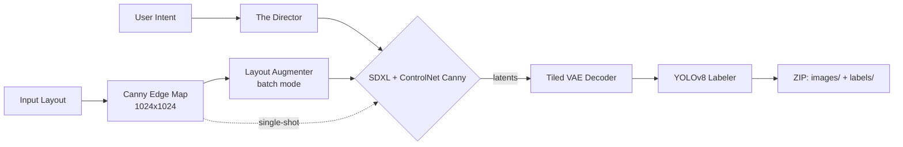

# EdgeForge AI ⚒️

**Turn one sketch or layout into a labelled computer-vision dataset, on your own GPU.**

## 🚀 What is EdgeForge?

EdgeForge is a **Synthetic Data Platform** built for startups and engineers who need computer-vision training data without the high cost of manual collection.

It transforms a **single input sketch/layout** into **batches of diverse, labelled training images**. The layout's edges constrain an SDXL + ControlNet generator, a prompt engine adds hard conditions (fog, night, rain, rust, motion blur and more), a layout augmenter adds geometric variety, and a YOLOv8 model writes bounding-box labels in YOLO format. You get back a `.zip` with `images/` and `labels/` folders.

### **Key Features**

* **🎨 Memory-efficient high-res decoding:** A custom **Tiled VAE** decodes latents in 512 px tiles ("fractional batches") with Gaussian-weighted blending, so decoder VRAM is set by the tile size, not the image size. The generation pipeline produces 1024×1024 images. `tests/benchmark.py` stress-tests the decoder on 4096×4096 latents and reports peak VRAM.
* **🏷️ Automated Annotation:** An integrated **YOLOv8** auto-labeller writes standard YOLO-format (`.txt`) bounding boxes for every generated image.
* **🏭 The Dataset Factory:** Batch mode produces unique variations of one intent. Each image gets a different visibility, weather or damage condition and a different random seed.
* **📐 Layout Augmentation:** Shifts, scales, flips and multiplies the input layout to create geometric diversity (for example, "1 car" → "3 cars in the distance").
* **🧠 The Director:** A rule-based prompt engine that expands simple intents (for example, "a rusty car, hard to see") into detailed photorealistic prompts. It's built as a drop-in point for an LLM later.
* **🌐 API + UI:** A FastAPI backend (with interactive docs at `/docs`) and a React/Vite frontend.

---

## 🏗️ Architecture



| Stage | Module | What it does |
| --- | --- | --- |
| Edge extraction | `pipeline.py` → `preprocess_canny` | Resizes the upload to 1024×1024 and runs Canny edge detection (thresholds 100/200). |
| Layout augmentation | `layout_engine.py` → `LayoutAugmenter` | Pastes 1–3 copies of the edge map, each scaled 0.4–0.75×, randomly placed and flipped half the time, onto a blank canvas. Works best with a single object on a plain background. |
| Prompting | `prompt_expander.py` → `PromptExpander` | **Single-shot:** matches keywords ("hard to see", "rain", "damage", ...) to failure-mode modifiers. **Batch:** samples a random condition and seed per image. Both append quality boosters and a negative prompt. |
| Generation | `pipeline.py` → `EdgeForgePipeline` | `stabilityai/stable-diffusion-xl-base-1.0` with `diffusers/controlnet-canny-sdxl-1.0` (conditioning scale 0.5), fp16 with model CPU offload, returns **latents**. |
| Decoding | `tiled_vae.py` → `TiledVAEWrapper` | Decodes the latents with the fp32 SDXL VAE in 512 px tiles with 64 px overlap. Each tile is weighted by a 2-D Gaussian mask and accumulated in CPU buffers, then normalised, so tile seams blend away. |
| Labelling | `labeler.py` → `AutoLabeler` | YOLOv8n (COCO-pretrained) detections with confidence > 0.4, written as `class x_center y_center width height` (normalised). |

---

## ⚡ Quick Start (Hybrid Mode)

Use the hosted UI with the engine running on your own GPU.

1.  **Run the Engine (your GPU):** Build and run the Docker image (see [Option A](#option-a-docker-recommended) below). The first start downloads the model weights, so wait for `Factory Ready! 🚀` in the logs.

2.  **Open the Web Interface:** Go to **[https://edgeforge-ai.vercel.app](https://edgeforge-ai.vercel.app)**. The page calls the engine at `http://127.0.0.1:8000` directly from your browser. If your browser blocks requests from the hosted page to localhost, run the frontend locally instead (`npm run dev`, see Option B).

3.  **Generate:** Upload a layout, describe the intent, choose a batch size and click **Generate Asset**. The dataset downloads as a `.zip`. You can generate as many datasets as you like for free on your own hardware.

---

## 🛠️ Installation (Local Development)

### **Prerequisites**

* NVIDIA GPU with CUDA (8 GB+ VRAM recommended). The pipeline runs SDXL in fp16 with CUDA model offload, so a CPU-only setup isn't practical.
* Docker with the NVIDIA Container Toolkit (for Container mode) OR Python 3.10–3.12 (for Source mode). `numpy<2` has no Python 3.13 wheels.
* Disk space for model weights. The first start downloads SDXL base, the SDXL Canny ControlNet and the SDXL VAE from Hugging Face (well over 10 GB in total), and ultralytics downloads `yolov8n.pt` automatically. No weights are stored in this repo.

### **Option A: Docker (Recommended)**

Build the container yourself to ensure all dependencies are locked.

```bash
# 1. Clone the repository
git clone https://github.com/yashsinha1702/edgeforge-ai.git
cd edgeforge-ai

# 2. Build the image (takes ~10 mins the first time)
docker build -t edgeforge-ai .

# 3. Run it. Mount the Hugging Face cache so model weights download only once.
docker run --gpus all -p 127.0.0.1:8000:8000 \
  -v ~/.cache/huggingface:/root/.cache/huggingface \
  edgeforge-ai
```

The image is based on `pytorch/pytorch:2.1.0-cuda12.1-cudnn8-runtime`, so PyTorch with CUDA 12.1 is preinstalled.

### **Option B: Manual Python Setup**

```bash
# 1. Create an environment and install PyTorch with CUDA first
python -m venv .venv && source .venv/bin/activate
pip install "torch>=2.1.0" --index-url https://download.pytorch.org/whl/cu121

# 2. Install the remaining dependencies
pip install -r requirements.txt

# 3. Start the Backend Server (src/ must be on PYTHONPATH, as in the Dockerfile)
PYTHONPATH=src python -m uvicorn src.app.main:app --host 127.0.0.1 --port 8000 --reload

# 4. Start the Frontend (in a new terminal), then open the URL Vite prints (default http://localhost:5173)
cd frontend
npm install
npm run dev
```

---

## 📚 Usage Guide

### **1. Single-Shot Mode (Prototyping)**

* **Best for:** Testing prompts and layouts.
* **Input:** Upload a coarse layout (for example, a white car on a black background) or a Canny edge map, and set the batch size to 1.
* **Output:** `edgeforge_asset.zip` containing `generated_image.png` (1024×1024) and `generated_image.txt` (YOLO labels). Single-shot uses a fixed seed (42), so results are repeatable for the same input.

### **2. Batch Factory Mode (Production)**

* **Best for:** Creating the actual training dataset.
* **Batch Size:** The UI slider goes from 2 to 10. The API accepts any integer.
* **Process:**
  1. **Augment:** The engine randomly shifts, scales, flips and multiplies the input layout for every image.
  2. **Generate:** Each image gets a randomly sampled condition: low visibility (fog, night, blizzard, motion blur), weather (rainstorm, harsh sunlight) or damage (rust, dents, dirt).
  3. **Label:** YOLOv8 detects objects in each new image.
* **Output:** `edgeforge_dataset.zip` containing:
  * `images/train_0000.png`, ... (the generated synthetic data)
  * `labels/train_0000.txt`, ... (YOLO text files)

### **3. Using the API directly**

```bash
# Single image
curl -X POST http://127.0.0.1:8000/generate \
  -F "intent=a rusty car on a street, hard to see" \
  -F "control_image=@layout.png" \
  -o edgeforge_asset.zip

# Batch of 10
curl -X POST http://127.0.0.1:8000/generate_batch \
  -F "intent=a car on a highway" \
  -F "batch_size=10" \
  -F "control_image=@layout.png" \
  -o edgeforge_dataset.zip
```

Interactive API docs are available at `http://127.0.0.1:8000/docs`.

> **Labels note:** The class IDs are COCO indices from the pretrained YOLOv8n model (for example, `2` = car). They're machine-generated pseudo-labels, so spot-check them before training. The zip doesn't include a class-name file.

---

## 🧪 Benchmarks & Tests

```bash
# Tiled VAE stress test: decodes random 4096x4096 latents and prints time and peak VRAM (GPU required)
PYTHONPATH=src/efficient_diffusion_loader python tests/benchmark.py

# End-to-end generation from src/input_layout.jpg -> output_director_test.png (GPU required)
cd src && python test_generation.py
```

There's no CPU-only unit-test suite yet. Running bare `pytest` collects `src/test_generation.py`, which loads the full SDXL pipeline at import time, so run the scripts above directly instead.

---

## 📂 Project Structure

```text
edgeforge-ai/
├── src/
│   ├── app/main.py                    # FastAPI app: /generate and /generate_batch
│   ├── efficient_diffusion_loader/
│   │   ├── pipeline.py                # SDXL + ControlNet (Canny) pipeline + tiled decode
│   │   ├── tiled_vae.py               # Tiled VAE decoder with Gaussian blending
│   │   ├── prompt_expander.py         # "The Director": rule-based prompt expansion
│   │   ├── layout_engine.py           # Layout augmenter: shift / scale / flip / multiply
│   │   └── labeler.py                 # YOLOv8 auto-labeller -> YOLO .txt
│   ├── test_generation.py             # Manual end-to-end generation script (GPU)
│   └── input_layout.jpg               # Sample input for test_generation.py
├── tests/benchmark.py                 # Tiled VAE time / VRAM benchmark at 4096x4096 (GPU)
├── frontend/                          # React + Vite UI
├── TiledVAEWrapper.py                 # Earlier standalone version of the tiled decoder
├── Dockerfile                         # CUDA 12.1 / PyTorch 2.1 runtime image for the API
├── requirements.txt
└── setup.py                           # Packages efficient_diffusion_loader
```

---

## ⚠️ Limitations & Security

* **Synchronous generation:** Each request blocks until the whole batch is generated and zipped in memory, so very large batches are slow and memory-hungry. A job queue with progress reporting is the natural next step.
* **Output resolution:** The pipeline currently generates 1024×1024 images. The tiled decoder scales further, but larger generation sizes aren't wired up.
* **The Director is rule-based:** It uses keyword matching and random sampling from a fixed ontology. Its structured `constraints` output is informational and not yet consumed downstream.
* **No authentication:** The API allows all CORS origins and has no auth, so any web page you open could send it requests. Keep it bound to `127.0.0.1` (as in the commands above) and don't expose port 8000 on untrusted networks.

---

## 🤝 Contributing

We welcome pull requests! Please make sure you test the **Batch Generation** flow before submitting, as it's the core value proposition.

## 📄 License

This project is licensed under the MIT License. See the [LICENSE](LICENSE) file for details.
